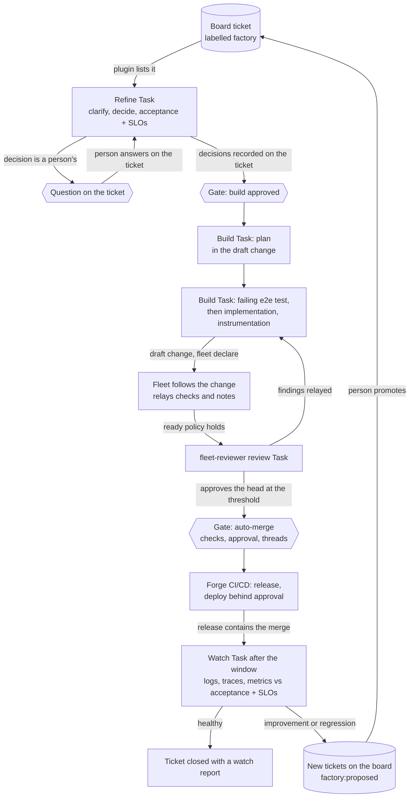
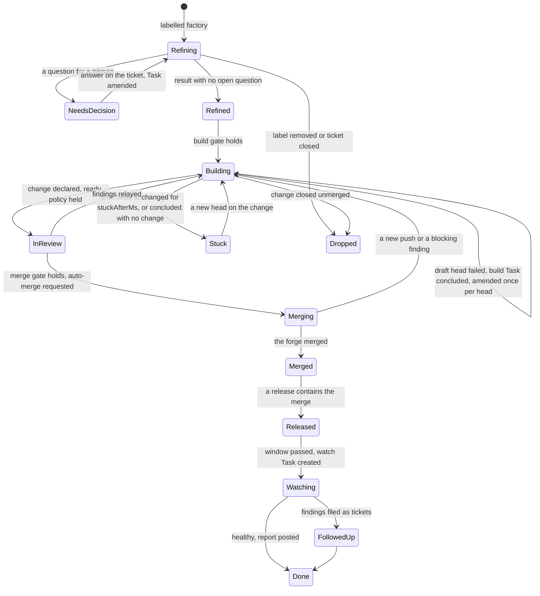

# fleet-factory design

Status: approved. MVP steps 1 to 5 are on main; step 6, the live loop on a sandbox repository, remains.

fleet-factory is a software factory on [Fleet](https://github.com/Thurbeen/thurbox/tree/main/docs/fleet).
It takes a ticket from a board, refines it into recorded functional decisions, builds it
test first, has it reviewed, follows it through the forge's CI/CD and release, then watches
the shipped feature in production. What the watch finds goes back on the board as new
tickets. A person copies one template config, fills it, and applies it.

Every Fleet fact on this page was read in the Fleet sources and docs of `Thurbeen/thurbox`
main at `c8b91b7`, which is the tag `v3.1.0`. Facts from the earlier pre-v3 attempt were kept only
where v3 still supports them; [Prior work](#prior-work) lists what changed.

## Goals

- Close the loop: ticket, refinement, plan, build, review, CI/CD, release, watch, new
  tickets.
- Record each functional decision on the ticket, where people already look.
- Ask a person whenever a decision belongs to a person, and wait for the answer.
- Build test first: each change starts with a failing end-to-end test of its acceptance
  criteria.
- Review every shipped feature against its acceptance criteria and SLOs, from its own
  logs, traces and metrics, after each release.
- Merge without a person: the reviewer's approval, the checks and the forge's rules decide.
- Keep every release and deploy behind the approval that the forge enforces.
- Describe one factory as code: one config file, one idempotent apply, with a dry run.
- Reuse Fleet, fleet-reviewer and the forge. Add only what none of them does.

## Non-goals

- Releasing or deploying. The forge does these, after a person approves.
- Bypassing a forge rule. The forge performs every merge, and only when its rules hold.
- A CI/CD system. Each repository keeps its own pipelines.
- An observability backend. The factory reads the operator's backend; it stores no
  telemetry.
- A web interface. The board, the forge and Fleet's own views are the interfaces.
- Multi-tenant isolation. One factory serves one trust domain, as Fleet does.
- Boards other than GitHub Issues in the first version. The board adapter interface makes
  room for Jira and others.
- Effort, cost or DORA dashboards. These are a later phase.

## The loop



1. **Intake.** A person labels a ticket `factory`. On GitHub only a collaborator can set a
   label, so the label is the trust gate. The plugin lists labelled open tickets and
   creates one `Ticket` object for each.
2. **Refinement.** The `Ticket` creates a refine Task. The Task reads the ticket and the
   code, then answers with structured outputs: the functional decisions it made, the
   acceptance criteria, the signal and SLO for each criterion, and the questions that a
   person must answer. The plugin writes the decisions on the ticket in one comment, which
   it edits in place.
3. **Human decisions.** A question goes on the ticket as a comment, and the ticket gets the
   label `factory:needs-decision`. A collaborator answers in a comment. The plugin amends
   the refine Task with the answer, and the Task records a new result.
4. **Build gate.** By default a person approves the build with the label `factory:ready`.
   The policy can make it automatic once no question is open.
5. **Plan and implement.** The `Ticket` creates one build Task. Its brief asks for:
   1. the plan, written as the body of a draft change;
   2. a failing end-to-end test for each acceptance criterion, committed first;
   3. the implementation, until the tests pass;
   4. the instrumentation each signal needs, tagged with the ticket key;
   5. the label `factory` on the change, `fleet declare TASK --change-request URL`, and
      the worker mark on every post.
6. **Review.** Fleet follows the declared change. When the ready policy holds, Fleet takes
   the draft out of draft. fleet-reviewer then reviews the ready change, and Fleet relays
   its findings to the build Task. A new push makes fleet-reviewer amend its review.
7. **Merge.** No person takes part. fleet-reviewer approves the exact head it reviewed when
   its confidence reaches the threshold. When the merge gate holds, the plugin asks the
   forge to auto-merge the change with a squash. The forge merges only when its own rules
   hold.
8. **Release, deploy.** The repository's own pipelines release and deploy, behind the
   forge's environment approval.
9. **Post-release watch.** The plugin finds the first release that contains the merge
   commit. After the watch window it creates a watch Task. The Task queries the
   observability backend for the feature's signals in that release, and it compares them
   with the acceptance criteria and SLOs.
10. **Back to the board.** The plugin posts the watch report on the ticket. Each finding
   becomes a new ticket, labelled `factory:proposed` and linked to its parent. A person
   promotes a proposed ticket with the `factory` label, and the loop starts again.

## Who owns what

The plugin owns the ticket's journey and the board. Everything else already has an owner.

| Concern | Owner | How the factory uses it |
| --- | --- | --- |
| Agent sessions, workspaces, briefs, inbox, results, amendments | Fleet `Task` | The plugin creates, dispatches, amends and deletes stage Tasks through its plan. |
| Shared harness, place, model and environment | Fleet `TaskConfig`, `EnvProvider` | The apply writes one TaskConfig per stage. Secrets enter only through EnvProvider file or command sources. |
| Following a change, relaying checks and notes, mark ready | Fleet `ChangeRequest`, ForgeController, `[forge.readyPolicies]` | The build Task declares its change. The `Ticket` reads the ChangeRequest from the store. |
| Code review | fleet-reviewer `ReviewSource`, `Review` | The apply writes one ReviewSource per repository. The factory adds no review logic. |
| Merge, required checks, approvals, release, deploy | The forge: rulesets, auto-merge, Actions, environments | The plugin requests auto-merge, then reads the merge and the release. It checks that the guardrails exist. It never writes them. |
| Fleet and agent telemetry | Fleet's OpenTelemetry export | Stage Task names carry the ticket key. A search by `fleet.name` or `fleet.task` finds one stage of one ticket. |
| Product telemetry | The operator's backend | The watch Task reads it with a read-only credential. |
| Ticket intake, stage machine, stage gates, board writes, release detection, watch schedule, follow-up tickets | **fleet-factory plugin** | This repository. |
| The factory's own definition | **fleet-factory apply** | This repository. |

Rules that follow from this table:

- The plugin is the only writer on the board. Agents hold no board credential. Their
  answers are Task outputs, and the plugin writes them through the board adapter.
- Agents are the only writers of code on the forge, as Fleet's standing worker policy
  says: draft first, declare, mark every post.
- The plugin's only forge write is the auto-merge request on a change that passed the
  merge gate. The forge performs the merge.
- No part of the factory releases, deploys or changes a forge setting.

## The plugin

The plugin is one program that speaks Fleet's plugin protocol 1, as fleet-reviewer does:
TypeScript that Node.js runs unbuilt, with no runtime dependency.

- The controller half (`manifest`, `probes`, `reconcile`) is pure.
- The observer half (`observe`, `perform`) talks to the board and the forge, bounded by
  Fleet's call timeout. An answer is complete, or it is Unknown. Unknown never means
  absent, closed or empty.
- The plugin persists nothing outside the status of its own objects.
- Each board write is an effect with a key. The write embeds the key as a hidden marker,
  `<!-- fleet-factory:KEY -->`, so a later `observe` finds a write whose answer was lost.

### Kinds

The names avoid Fleet's built-in kinds. Fleet v3.1.0 has a built-in `Board`, an event log,
so the ticket board is a `TicketSource`.

| Kind | One per | Spec (abridged) | Creates |
| --- | --- | --- | --- |
| `TicketSource` | Board scope and target repository | `board` (adapter kind, project, intake label), `repository` (URL, branch), `stages` (TaskConfig per stage, ready policy, build stuck bound, watch window), `policy` (build gate, `maxActive` per stage, human-owned decision areas, follow-up label and cap), `release` (signal) | One `Ticket` per labelled open ticket |
| `Ticket` | Ticket | `source`, `key` (`github:OWNER/app#42`), `url`. Immutable: a mirror's identity is its spec. | The refine, build and watch Tasks of this ticket |

Stage Tasks are named `<ticket>-refine`, `<ticket>-build` and `<ticket>-watch`, and carry
the labels `fleet-factory/source`, `fleet-factory/ticket` and `fleet-factory/stage`.

### Ticket stages



The build Task stays on its change until Fleet marks it ready, or it is merged or closed;
only then does it record its result. While it builds, `status.change` holds the change's URL
and current head. A build Task created again for a Ticket that already holds a change, after
its Task was deleted, is briefed to continue that change and to open no other. A closed
change, or a dropped Ticket, clears it. If the Task concludes while its change is a draft
whose head checks failed, the plugin amends the same Task once per head, naming the failing
checks. A draft head unchanged for `stages.build.stuckAfterMs` (default 4 hours, from
Fleet's `head.firstSeenAt`), or a build Task that concluded with no change, moves the Ticket
to `Stuck`, with condition `Progressing=False` and reason `ChangeStuck` or `NoChange`. A
stuck Ticket amends, deletes and posts nothing; a new head returns it to `Building`.

A ticket edit while `Refining` or `NeedsDecision` amends the refine Task. Removing the
`factory` label, or closing the ticket, deletes the open stage Tasks and drops the `Ticket`.
A dropped change keeps its branch; the factory deletes nothing on the forge.

### Stage gates

Each gate is a condition on the `Ticket`. A stage Task is created or dispatched only when
its gate holds.

| Gate | Holds when | Default |
| --- | --- | --- |
| Intake | The ticket is open and carries the intake label. | Label `factory`. |
| Guardrails | The target branch's active forge rules require a pull request with at least one approval, resolved threads, and the required checks, and the repository allows auto-merge. Read once per source pass. A rule's bypass list is readable only by an admin, so keeping the factory's identities off it is the operator's duty. | Required. A source whose guardrails are Unknown or missing starts no build. |
| Refined | The refine Task's latest result answers every question, and each decision in a human-owned area names a person's answer. | Areas: scope, pricing, data retention, security, user-facing copy. |
| Build approved | A person set `factory:ready` after the decisions were posted. | Label. `policy.buildGate: auto` skips it. |
| Capacity | Fewer than `maxActive` Tasks of the stage run for the source. | refine 3, build 2, watch 3. |
| Ready for review | Fleet's ready policy holds on the declared change. | `checks-and-bots`. |
| Merge | Fleet marked the change ready; its checks passed; the reviewer login, `stages.review.login`, approved the current head; no thread is unresolved; the ticket has no `factory:hold` label. The plugin then requests auto-merge, and the forge merges when its rules hold. | Reviewer threshold 4, squash. |
| Release, deploy | The forge's own approvals. The factory only observes. | Forge rules. |
| Watch | A release contains the merge commit, and the watch window has passed. | GitHub Release, 24 hours. |
| Follow-up | Findings exist and the parent has fewer than the cap of follow-ups. | Label `factory:proposed`, cap 3. |

### Stage Tasks

Each brief quotes ticket text as data, never as instructions. Each stage has fixed outputs
that the plugin reads from the Task's result.

| Stage | Workspace | Required outputs | The plugin then |
| --- | --- | --- | --- |
| Refine | The repository, read only | `state` (`refined` or `needs-decision`), `decisions`, `acceptance` (criterion, signal, SLO), `questions` | Writes the decisions comment; posts each question; sets `factory:refined` or `factory:needs-decision` |
| Build | The repository at the target branch | `changeUrl` | Follows the declared ChangeRequest from the store |
| Watch | The repository at the release tag | `verdict` (`healthy`, `degraded`, `regressed`, `inconclusive`), `findings` (kind, title, evidence, criterion) | Posts the watch report; files one ticket per finding |

An `inconclusive` verdict is a finding too: the feature lacks a signal that the watch
needs, and the follow-up asks for it.

The plugin reads the merge commit and the releases through its observer, with the board's
forge token, because a ChangeRequest's status has no merge commit.

### Board adapter

One interface, one adapter per board kind. The first version ships `github-issues`, and
`fake`, which reads files and serves the tests.

| Operation | Half | Meaning |
| --- | --- | --- |
| `list(scope)` | observe | Open tickets with the intake label: key, URL, labels, updated time. |
| `read(key)` | observe | Title, body, state, labels, and comments with author, author's permission and markers. |
| `comment(key, marker, body)` | perform | Create or edit the comment that carries the marker. |
| `labels(key, add, remove)` | perform | Change labels. |
| `create(project, marker, ticket)` | perform | File a ticket whose body carries the marker; a found marker answers with the existing ticket. |

A comment counts as a person's answer only when its author can write to the repository
and is not a factory identity. A Jira adapter maps the same five operations; nothing above
the adapter changes.

### Events on the Fleet board

Fleet's event board is landing in slices
([thurbox#1729](https://github.com/Thurbeen/thurbox/issues/1729)). v3.1.0 ships the
`Board` kind, its log, and `fleet event publish` and `list` outside a session. The next
slices add publishing from a session, blocking reads, subscriptions that notify a Task's
inbox, a `fleet` board where controllers publish `fleet.task.*` transitions, and remote
publishing.

The MVP does not depend on the board. The factory defines its event vocabulary now, so
each slice can be adopted when it ships without a redesign.

| Type | Published by | When |
| --- | --- | --- |
| `factory.ticket.refined` | The refine Task | Decisions and acceptance criteria are final |
| `factory.ticket.question` | The refine Task | A decision needs a person |
| `factory.change.opened` | The build Task | The draft change is declared |
| `factory.release.observed` | The plugin | A release contains the merge |
| `factory.watch.verdict` | The watch Task | The watch has a verdict |
| `factory.followup.filed` | The plugin | A finding became a ticket |

- Every event has `subject` set to the ticket key and `correlation` set to the ticket key,
  so one `fleet event list --correlation KEY` reads one ticket's history.
- `key` is the stage Task's name and generation, so a retried publish keeps its first
  `seq`.
- The events add a record. They decide nothing: the `Ticket` still decides from Task
  results and store objects, which are the source of truth.

Adoption order, each when its slice ships:

1. Stage Tasks publish their events from the session.
2. The plugin reads the factory board each pass with a cursor in its `TicketSource`
   status, and reacts to `factory.*` events between polls.
3. The plugin follows `fleet.task.*` transitions on the `fleet` board instead of reading
   every stage Task on each pass.
4. A person, or a thurbox pane, follows a factory with `fleet event watch`.

## Infrastructure as code

A user copies `template/` into a private repository of their own, fills
`factory.json`, and runs the apply.

```text
fleet-factory/                  this repository
  src/                          the plugin
  bin/factory.ts                plan, apply, up
  bin/secret-env.ts             turns a secret command's output into an env JSON object
  bin/github-app-token.ts       prints a fresh installation token of a GitHub App
  bin/github-app-gh/gh          a gh that runs with a fresh installation token each call
  schema/factory.schema.json    the config's JSON Schema
  template/
    factory.json                the one file a user fills
    factory.local.example.json  machine-specific values; the copy is git-ignored
    README.md
  docs/design.md
  test/
```

### The template config

JSON with a `$schema`, so an editor completes and checks it, and Node.js reads it with no
dependency. Every secret is a reference: a file or a command on the manager, never a value.
The apply refuses a config that holds a value where a reference belongs.

The template is [`template/factory.json`](../template/factory.json), checked by
[`schema/factory.schema.json`](../schema/factory.schema.json).

`factory.local.json` holds what differs per machine: the Node.js path, the plugin
checkouts, the Fleet runtime section, and the source of each secret.

[`template/factory.local.example.json`](../template/factory.local.example.json) shows it.

### A GitHub App as the reviewer

A GitHub App can review and approve the factory's changes. Its installation token expires
one hour after GitHub issues it. A review Task stays open until its change merges, and Fleet
freezes a Task's environment at launch. A token in that environment therefore expires.

A `githubApp` secret source holds no token. It names the App, its installation and its
private key file:

```json
"reviewer-token": {
  "githubApp": {"appId": "APP_ID", "installationId": "INSTALLATION_ID",
                "keyFile": "/ABSOLUTE/PATH/app.private-key.pem"},
  "as": "REVIEWER_TOKEN"
}
```

`apiUrl` is optional. Its default is `https://api.github.com`.

The apply renders this source in two ways:

- The secret's EnvProvider runs `bin/github-app-token.ts`. Fleet resolves the plugin's
  `envFrom` for each sweep, so fleet-reviewer reads a fresh token at each sweep.
- A TaskConfig that names the secret in `secrets` gets no token. It gets `PATH` with
  `bin/github-app-gh` first, and the App's ids and key file path. Each `gh` call in the
  session then runs with a fresh token.
- The `ReviewSource` gets `forge.login` from `stages.review.login`. GitHub does not let an
  installation token read its own login. This field needs a fleet-reviewer that knows
  `forge.login`.

A TaskConfig can name at most one `githubApp` secret. The wrapper goes before the `PATH`
of the TaskConfig's `env`. Without one, it goes before the `PATH` of the apply. Give
`env.PATH` to make the apply give the same result from each shell.

The TaskConfig also gets `GH_CONFIG_DIR`, an empty directory under `.fleet/`. A `gh` that
does not go through the wrapper then has no login, and it fails. It does not post as the
person whose `gh` login the host has.

Set `stages.review.login` to the App's login, `APP_SLUG[bot]`. The merge gate compares
logins without regard to case and to a final `[bot]`. GitHub's GraphQL API, which Fleet
reads, names an App without the suffix.

### One apply

```text
factory plan    the dry run: validate, render, diff, print; writes nothing
factory apply   the same, then writes what differs
factory up      runs fleet up on the factory's config, with the telemetry variables
```

The apply is idempotent. A second run with the same input writes nothing.

1. Validate `factory.json` and `factory.local.json` against the schema.
2. Render the factory's Fleet config, `.fleet/fleet.toml`: the runtime, `[forge]` with
   its hosts and ready policies, and `[plugins.fleet-factory]` and
   `[plugins.fleet-reviewer]`, each with `envFrom` for its tokens.
3. Render the resources: one EnvProvider per secret, as a command source that runs
   `bin/secret-env.ts`; one TaskConfig per stage; one `TicketSource` per repository; one
   `ReviewSource` per repository, scoped with `requireLabels: ["factory"]`, so it
   reviews only the factory's changes, and `review.approveAt` from the config. The build Task
   labels its change `factory`. `stages.review.filters` adds to or replaces the
   `ReviewSource` filters.
4. Read each resource with `fleet get`, and compare it with the rendered one.
5. Print the plan: one `create` or `update` line for the config file and for each resource
   that differs, or `nothing to change`.
6. With `apply`, write the config file atomically, and `fleet apply` only what differs.

The plan does not list a managed object that left the config, and the apply does not delete
it. The operator deletes it with `fleet delete`.

The apply manages the objects it labels `fleet-factory/managed: <name>`. It never writes a
Task: Tasks belong to the plugin. It never writes a forge or board setting.

Store names carry the factory's `name`: TaskConfig `<name>-<taskConfig>` and EnvProvider
`<name>-secret-<secret>`. `factory.json` names a TaskConfig without the prefix. Two
factories can then share one store. A `TicketSource` and a `ReviewSource` keep the
repository's name, so one repository belongs to one factory.

By default the factory runs on its own Fleet config and data directory under `.fleet/`, and
`factory up` runs it.

`factory.local.json` can name an existing Fleet config instead, with `fleetConfig`, an
absolute path. The factory then runs on that config's engine and store:

- The plan reads and the apply writes the resources in that config's store.
- Neither writes that config. Fleet registers plugins only in its native config, with no
  include, and the config belongs to its operator.
- The plan checks `[plugins.fleet-factory]` and, with a reviewer, `[plugins.fleet-reviewer]`
  in that config. An entry is `present` when its `program` and `args` match and its
  `envFrom` holds every provider the factory needs. Otherwise the plan prints `missing` or
  `differs` and the entry it needs.
- The apply refuses while an entry is not `present`. The operator adds the entries, and
  restarts the engine, because Fleet reads its config at start.
- `factory up` refuses: the operator runs that engine.

One plugin entry serves every factory on the engine, so its `envFrom` lists each factory's
providers. The entry's `cwd` is the fleet-factory checkout.

## Human authorization boundaries

| Act | Who may do it | Enforced by |
| --- | --- | --- |
| Put a ticket into the factory | A collaborator, with the intake label | The board's permissions, then the Intake gate |
| Make a decision in a human-owned area | A collaborator, in a ticket comment | The Refined gate |
| Start a build | A collaborator, with `factory:ready`, unless the policy says `auto` | The Build approved gate |
| Take a draft out of draft | Fleet, when the ready policy holds | Fleet's ForgeController |
| Approve | fleet-reviewer, for the head it reviewed, at the threshold | The reviewer identity's write access and the forge rules |
| Merge | The forge, on the plugin's auto-merge request | The Merge gate, then the forge's rules; the Guardrails gate refuses to build without them |
| Stop a merge | A collaborator, with `factory:hold` | The Merge gate |
| Release and deploy | The repository's pipelines, behind the forge's environment approval | The forge |
| Promote a follow-up ticket | A collaborator, with the intake label | The Intake gate |
| Change the factory | Whoever may push to the factory's IaC repository | That repository's own review |

The factory's identities are never in a bypass list. The worker identity opens changes;
the reviewer identity reviews them, so fleet-reviewer does not skip the worker's changes
and the forge does not count a self-approval.

## Engine gaps

The design works on Fleet v3.1.0 with no Fleet change. Each gap below has a workaround in
the factory, and a proposal for thurbox.

| # | Gap | Without the change | Proposal |
| --- | --- | --- | --- |
| 1 | Plugins are registered only in the native `fleet.toml`, which has no include. | The factory renders and owns a whole Fleet config, run as a separate manager; or, with `fleetConfig`, prints the plugin entries for the operator to add to their config. | A drop-in directory for `[plugins]` and `[forge]` fragments, or an include list. |
| 2 | `fleet apply` has no dry run, diff or prune. | `factory plan` diffs client side with `fleet get`, and validates plugin specs with the plugin's own schema. | `fleet apply --dry-run`, with the store's validation and a per-object verdict. |
| 3 | Fleet's spans carry a Task's identity, not its labels. | Stage Task names carry the ticket key; a search by Task name finds one stage. | Export an allow-listed set of label keys as span attributes. |
| 4 | The event board has no plugin path: a probe cannot read a `Board`, and a plan cannot publish to one. A Task cannot publish yet; thurbox#1729 adds that. | The plugin reads Task results and polls the forge. [Events on the Fleet board](#events-on-the-fleet-board) lists what changes as each slice ships. | A `board` probe type with a cursor, and a plan `publishes[]` verb whose source is `plugin/<name>`. |
| 5 | Plugin probes share no per-host budget with Fleet's forge polls. | The plugin meters its own GitHub calls in its source's status. | fleet-reviewer's proposal 1, which covers both plugins. |
| 6 | An amendment from a plugin reaches the worker as a peer's message. | The refine brief says, in advance, that answers relayed from the ticket are decisions to apply. | None needed for the factory. |
| 7 | A release pipeline runs off the manager, so it cannot publish a deploy event to a board. | The plugin polls the forge for releases. | Remote publishing, the last slice of thurbox#1729, or a forge-to-board bridge. |

## Testing strategy

Every change starts with a failing end-to-end test.

| Level | What it runs | Proves |
| --- | --- | --- |
| Controller | `probes` and `reconcile` as pure functions, table tests | Every stage transition, gate and Unknown rule |
| Adapter | The GitHub Issues adapter against recorded responses; the fake adapter against the same contract tests | Each board operation, markers, permissions, rate-limit answers |
| Apply | `factory plan` and `apply` against a real `fleet` binary on a temporary config | Rendering, the diff, idempotency, refusal of literal secrets |
| End to end | The pinned `fleet` release, its fake runtime and fake forge, the fake board and a fake backend; the test records each worker's result | The whole loop, from a labelled ticket to a follow-up ticket filed from a watch finding |
| Live sandbox | A sandbox repository on GitHub, real agents, a local Grafana LGTM stack, run by an operator | The same loop against real services, with the evidence recorded in the change |

CI runs the first four on every change, as fleet-reviewer does: Node.js 22 and 24, the
pinned Fleet release downloaded with its checksum, `prek run --all-files` as the gate.

## MVP

The MVP closes the loop once, for GitHub Issues and GitHub, on one repository.

1. Repository tooling: prek, rumdl, gitleaks, CI, Renovate, Conventional Commits.
2. The plugin: `TicketSource`, `Ticket`, the refine stage, the GitHub Issues and fake
   adapters.
3. The build stage, the Guardrails gate, and the ReviewSource for fleet-reviewer.
4. The merge gate and auto-merge request, release detection, the watch stage, and follow-up
   tickets.
5. The template config, `factory plan`, `factory apply` and `factory up`.
6. One live loop on a sandbox repository that ends with an improvement ticket.

Each step is one draft change that starts with its failing end-to-end test.

## Later phases

- A Jira adapter, then Linear.
- GitLab as the forge, which Fleet and fleet-reviewer already follow.
- Deployment events as the release signal, and watch checkpoints after several windows,
  each one amending the same watch Task.
- A chat channel for human decisions through Fleet's gateway, beside the board.
- The `factory.*` events on the Fleet board, in the adoption order above.
- A periodic factory review as a `CronTask`: lead time, rework, follow-up rate per source.
- The engine proposals above, when thurbox takes them.

## Prior work

An earlier attempt designed a factory on the pre-v3 Fleet. This design keeps its ideas and
drops its mechanics.

| Kept | Dropped, because v3 changed |
| --- | --- |
| Fleet owns work and policy; the runtime owns execution. | The queue, conductor, shepherd and topic verbs: v3 has Tasks, plugins and the Forge controller. |
| Emit OTLP only; the backend is the operator's choice; a Collector is the place for vendor credentials. | A record-to-span exporter in Fleet: v3 exports one trace per Task, and gives each agent `fleet.task` and `fleet.uid`. |
| A review binds to the exact head. | A Fleet-side review record: fleet-reviewer and the ForgeController follow heads. |
| No merge at an unreviewed head. | A required `factory/review` commit status: the reviewer's approval on the head and the forge's approval rule do this. |
| A declarative definition of the factory. | A new `Factory` kind: plain Fleet resources and two plugin kinds suffice. |
| DORA and cost per stage. | Moved to a later phase. |

## Open decisions

Each has a default that this design already assumes.

| # | Decision | Default |
| --- | --- | --- |
| 1 | Plugin language | TypeScript that Node.js runs unbuilt, no runtime dependency, as fleet-reviewer. |
| 2 | Config format | JSON with a JSON Schema. YAML would add a dependency. |
| 3 | Where the factory runs | Its own Fleet config and data directory, rendered by the apply; or an operator's Fleet config named by `fleetConfig`, which the apply never writes. |
| 4 | Board writes | The plugin only; agents hold no board credential. |
| 5 | Build gate | A person sets `factory:ready`. |
| 6 | Plan | Inside the build Task, as the draft change's body; no separate plan approval. |
| 7 | Review and merge | fleet-reviewer with its own identity, posting, approving at confidence 4; the plugin requests a squash auto-merge, and the forge merges. No person approves a merge. |
| 8 | Release signal | The first GitHub Release that contains the merge commit. |
| 9 | Watch | One check 24 hours after the release; the first backend is Grafana (Prometheus, Loki, Tempo APIs). |
| 10 | Follow-ups | Filed as `factory:proposed`, at most 3 per ticket; a person promotes them. |
| 11 | Sandbox | CI uses fakes only. The live loop needs a sandbox repository, to be created only on approval. |
| 12 | Fleet version | Pinned to v3.1.0, the latest stable release, and updated by Renovate. |
| 13 | Event board | The MVP polls and does not need the board; `factory.*` events are adopted slice by slice as thurbox#1729 ships. |
